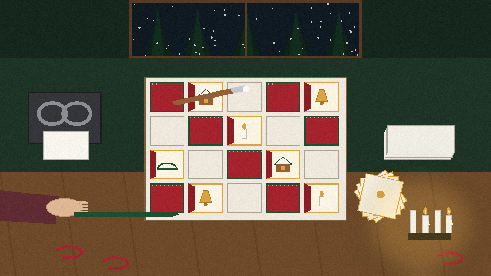

# Wallhaven-MacOS-Wallpaper


This is the method I use to get Wallhaven wallpapers onto macOS.

I personally recommend bulk downloading and then setting the wallpaper as the folder to which you bulk downloaded, this is a far superior approach to most tools:

```
https://bulkimagedownloader.com
```
- Windows only so use a virtual machine with a shared folder to macOS

> **Picture square:** Windows only. Bulk Image Downloader runs in a Windows virtual machine on the Mac, with a shared folder reaching macOS. This repository ships no code and downloads nothing itself.


## Diagrams and site

The hand drawn sheets for this method live in [Wallhaven-MacOS-Wallpaper-Visuals](Wallhaven-MacOS-Wallpaper-Visuals/) (architecture, data flow, flowchart, product map, schematic, and statistics, plus the combined PDF and the written VISUAL.md). The static site page for this repo lives in [Wallhaven-MacOS-Wallpaper-Website](Wallhaven-MacOS-Wallpaper-Website/). Neither adds new steps: both present the same method above.

> **Picture square:** the visuals and site folders add no new steps. Both present the same method.
